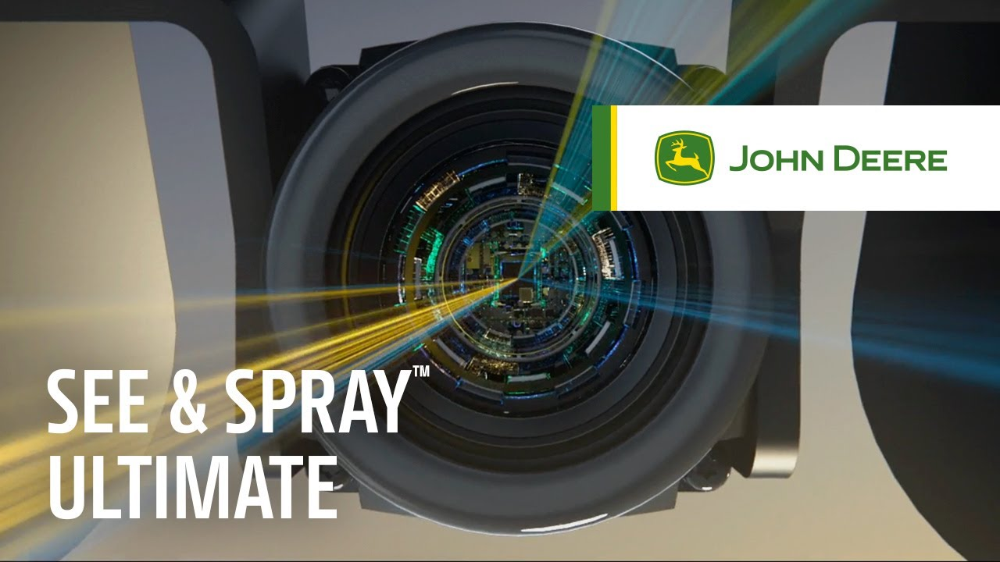

# LAPORAN TUGAS 1: VISI KOMPUTER
## Penerapan Visi Komputer dalam Kehidupan Nyata

---

### Informasi Tugas
* **Mata Kuliah** : Visi Komputer
* **Semester**    : Gasal / Semester 7
* **Topik**       : Penerapan Visi Komputer pada Pertanian Modern (*Smart Precision Agriculture*)
* **Kasus Studi** : *Targeted Spraying System* pada **John Deere See & Spray™ Ultimate**
* **Nama**        : [Nama Mahasiswa]
* **NIM**         : [NIM Mahasiswa]
* **Program Studi**: Teknik Informatika / Ilmu Komputer / Teknik Elektro
* **Fakultas**    : Fakultas Teknologi Informasi / Teknik
* **Universitas** : [Nama Universitas]

---

<div style="page-break-after: always;"></div>

## 1. Link Video dan Capture Menarik

### A. Informasi Video
* **Judul Video** : *See & Spray™ Ultimate Theory of Operation | John Deere*
* **Kanal / Sumber**: Official John Deere YouTube Channel
* **Tahun Rilis**  : 2022 (Dipublikasikan dalam rentang 5 tahun terakhir)
* **Link Video**   : [https://www.youtube.com/watch?v=ytJELX6rKV4](https://www.youtube.com/watch?v=ytJELX6rKV4)

### B. Capture Salah Satu Bagian Menarik dari Video



*Gambar 1: Tangkapan layar sistem John Deere See & Spray™ Ultimate yang memperlihatkan integrasi multi-kamera berkecepatan tinggi pada boom penyemprot 120 kaki, sistem inferensi visi komputer real-time, dan aktuasi presisi nozzle ExactApply™.*

#### Deskripsi Bagian Menarik:
Bagian yang paling menarik dari video ini adalah demonstrasi bagaimana sistem visi komputer mampu melakukan **"Green-on-Green Detection"** secara *real-time*. Ketika kendaraan bergerak melintasi ladang dengan kecepatan operasional hingga **12 mph (sekitar 20 km/jam)**, 36 kamera beresolusi tinggi terus memindai tanaman. 

Unit pemrosesan komputer (*Vision Processing Unit*) secara instan mendeteksi perbedaan morfologi daun antara tanaman pangan budidaya (misalnya jagung, kedelai, atau kapas) dengan gulma pengganggu (*weeds*), meskipun keduanya memiliki warna hijau yang identik. Bounding box dan inferensi klasifikasi dikalkulasikan dalam hitungan milidetik, lalu katup nozzle penyemprot membuka dan menutup secara presisi hanya pada titik gulma berada tanpa membasahi tanaman utama.

---

## 2. Pembahasan

### a. Kemampuan Visi Komputer (*Computer Vision Capabilities*)
Dalam sistem *See & Spray™ Ultimate*, beberapa kemampuan utama visi komputer yang diintegrasikan meliputi:

1. **Deteksi Objek (*Object Detection*) & Klasifikasi Citra (*Image Classification*)**:
   - Sistem tidak sekadar mendeteksi adanya vegetasi hijau, tetapi secara spesifik mengidentifikasi tipe objek di tingkat tanaman individual (*individual plant recognition*).
   - Klasifikasi berbasis Deep Learning membedakan tanaman budidaya (*cash crops*) dari berbagai spesies gulma umum (*broadleaf*, rerumputan liar) pada berbagai fase pertumbuhan bibit (*seedling to mature stage*).

2. **Diferensiasi Hijau-di-atas-Hijau (*Green-on-Green Discrimination*)**:
   - Berbeda dari visi komputer generasi awal (*Green-on-Brown*) yang hanya mengandalkan segmentasi warna (misalnya ruang warna HSV atau indeks vegetasi NDVI untuk mencari warna hijau di atas tanah kosong), sistem ini memproses fitur visual mendalam (*deep convolutional features*) seperti tekstur daun, pola urat daun, rasio kelengkungan tepi daun, serta arsitektur kanopi tanaman.

3. **Multi-Camera Synchronization & Edge Vision Processing**:
   - Menghubungkan dan menyinkronkan 36 kamera resolusi tinggi di sepanjang bentang boom serat karbon 120 kaki (sekitar 36,5 meter).
   - Seluruh pipeline inferensi berjalan secara terdistribusi di beberapa unit pemrosesan visi tepi (*Vision Processing Units* / VPU) dengan latensi ultra-rendah (*sub-200 milliseconds*).

4. **Visual Odometry & Integrasi Sensor Spasial**:
   - Menyelaraskan koordinat piksel frame citra kamera dengan pergerakan translasi traktor di medan bergelombang, didukung oleh sistem sensor ultrasonik *BoomTrac™* untuk kompensasi getaran dan variasi ketinggian boom.

---

### b. Penerapan (*Real-World Application*)
* **Sektor Penerapan**: Pertanian Presisi (*Smart / Precision Agriculture*).
* **Tujuan Penerapan**: Manajemen Pengendalian Gulma Selektif (*Targeted / Site-Specific Herbicide Application*).
* **Konteks Masalah Dunia Nyata**:
  - Pada metode pertanian konvensional, petani melakukan *broadcast spraying*—menyemprotkan herbisida secara merata ke seluruh permukaan lahan seluas ratusan hingga ribuan hektar. Hal ini memboroskan ratusan liter bahan kimia pada tanah kosong dan tanaman sehat yang tidak memerlukan racun.
  - Dampak negatif dari *broadcast spraying* mencakup: biaya operasional herbisida yang sangat tinggi, pencemaran air tanah, degradasi kesuburan mikroba tanah, serta percepatan resistensi genetik gulma terhadap herbisida.
* **Implementasi Nyata John Deere**:
  - Mesin *See & Spray™ Ultimate* dipasangkan pada traktor penyemprot mandiri (seri 400 dan 600).
  - Melalui arsitektur tangki ganda (*Dual-Product Solution*), traktor dapat menyemprotkan herbisida non-residual bertarget hanya pada gulma yang terdeteksi, sembari secara simultan melakukan penyemprotan pupuk daun atau herbisida residual secara terpisah dalam satu kali jalan (*single pass*).

---

### c. Cara Kerja Sistem (*System Pipeline & Architecture*)

Alur kerja visi komputer pada sistem ini dapat dirinci menjadi 6 tahapan utama:

```
[ Akuisisi Citra ] ──> [ Preprocessing ] ──> [ Inferensi Deep Learning (VPU) ]
   (36 Kamera)            (Koreksi Cahaya)         (Deteksi & Klasifikasi Gulma)
                                                                │
                                                                ▼
[ Laporan & Peta ] <── [ Aktuasi Nozzle ] <── [ Proyeksi Spasial & Kecepatan ]
 (Cloud Operations)     (ExactApply PWM)            (Kalibrasi GPS & Odometri)
```

1. **Akuisisi Citra Berkecepatan Tinggi (*Image Acquisition*)**:
   - 36 kamera digital berspesifikasi industri dipasang berjarak sekitar 1 meter di sepanjang sayap boom.
   - Kamera mengambil gambar kanopi tanah secara beruntun (*high frame rate*) dengan kemampuan adaptasi terhadap intensitas cahaya luar ruangan.

2. **Prapemrosesan Citra (*Image Preprocessing*)**:
   - Frame mentah dikoreksi terhadap distorsi lensa (*lens undistortion*), dinormalisasi tingkat eksposur dan white balance-nya untuk menanggulangi bayangan awan atau pantulan sinar matahari terik, serta diekstrak ke dalam representasi tensor yang optimal untuk model AI.

3. **Ekstraksi Fitur & Inferensi Deep Learning pada Edge (*CNN Inference*)**:
   - Model jaringan saraf tiruan konvolusional (*Deep Convolutional Neural Networks*) yang telah dioptimasi (misalnya arsitektur berbasis MobileNet, YOLO-variants, atau custom edge-backbone) memproses tensor citra.
   - Jaringan mendeteksi keberadaan tanaman, menghasilkan *bounding box* atau masker segmentasi, dan mengklasifikasikan label target: `Crop` (Tanaman Utama) atau `Weed` (Gulma).

4. **Proyeksi Koordinat Spasial & Estimasi Waktu (*Spatial Projection & Lookahead*)**:
   - Posisi piksel gulma dalam frame kamera dipetakan ke dalam koordinat fisik tanah menggunakan parameter kalibrasi kamera (*extrinsic matrix*).
   - Sistem memperhitungkan kecepatan laju traktor saat itu (dari sensor roda dan GPS RTK) serta jarak fisik antara posisi lensa kamera ke garis nozzle penyemprot di belakangnya (sekitar jarak tempuh 0,1 hingga 0,2 detik).

5. **Aktuasi Nozzle Presisi (*Precision Nozzle Actuation*)**:
   - Ketika titik tanah yang ditumbuhi gulma tepat berada di bawah nozzle penyemprot tertentu, sinyal kontrol dikirim ke aktuator *ExactApply™ Pulse Width Modulation (PWM)*.
   - Katup solenoid nozzle membuka hanya selama sekian milidetik untuk menyemprotkan mikrodosis herbisida ke gulma, lalu segera menutup kembali. Total waktu dari pemindaian visual hingga semprotan selesai berkisar antara **150–200 milidetik**.

6. **Pemetaan & Telemetri (*Agronomic Mapping*)**:
   - Setiap deteksi gulma dicatat bersama koordinat geospasialnya (*geotagged data*) dan disinkronkan ke platform *John Deere Operations Center™* via jaringan seluler untuk menyusun peta tekanan gulma (*weed pressure map*) bagi petani.

---

### d. Kelebihan (*Strengths & Advantages*)
1. **Pengurangan Bahan Kimia yang Sangat Signifikan**:
   - Mampu mengurangi pemakaian herbisida non-residual hingga **lebih dari 67% (bahkan mencapai 80%)** dibandingkan metode *broadcast spraying*.
2. **Penghematan Finansial Petani**:
   - Pengurangan biaya belanja bahan kimia herbisida hingga puluhan ribu dolar per musim tanam untuk lahan berskala komersial (ribuan acre/hektar).
3. **Ramah Lingkungan & Berkelanjutan (*Eco-Friendly*)**:
   - Meminimalkan residu bahan kimia sintetis yang meresap ke dalam air tanah dan menjaga keanekaragaman hayati mikroorganisme tanah yang menguntungkan.
4. **Mencegah Resistensi Gulma**:
   - Karena volume yang dihemat sangat banyak, petani dapat mengaplikasikan bahan kimia campuran yang lebih efektif namun biasanya mahal, serta memanfaatkan sistem tangki ganda untuk menyerang gulma dengan dua mode aksi berbeda secara bersamaan.
5. **Kecepatan Operasional Sangat Tinggi**:
   - Sistem tetap akurat dan andal bekerja hingga kecepatan **12 mph (20 km/jam)**, memastikan efisiensi waktu kerja di lapangan yang setara dengan traktor konvensional.

---

### e. Kekurangan (*Limitations & Challenges*)
1. **Biaya Investasi Awal yang Sangat Tinggi (*Capital Expenditure*)**:
   - Harga unit sprayer dengan paket lengkap *See & Spray Ultimate* mencapai ratusan ribu dolar Amerika Serikat, menjadikannya kurang terjangkau bagi petani kecil atau menengah di negara berkembang.
2. **Ketergantungan Ekstrem pada Kondisi Lingkungan Nyata**:
   - Lingkungan pertanian menghasilkan debu pekat, serpihan tanah, lumpur, dan residu kimia yang dapat mengotori kaca lensa kamera sehingga membutuhkan mekanisme pembersihan dan inspeksi rutin.
   - Kondisi cahaya backlight rendah (matahari terbit/tenggelam bersudut tajam) menghasilkan bayangan panjang yang dapat mengaburkan siluet daun.
3. **Variabilitas Biologis dan Kebutuhan Data Latih yang Masif**:
   - Gulma memiliki ratusan varietas berbeda dengan bentuk morfologi yang bervariasi bergantung pada ketersediaan air, jenis tanah, dan suhu. Model visi komputer membutuhkan jutaan data latih teranotasi agar tidak mengalami *false positive* (menyemprot tanaman utama) atau *false negative* (melewatkan gulma).
4. **Kompleksitas Perawatan (*Maintenance Complexity*)**:
   - Adanya 36 modul kamera, puluhan kabel data, unit pendingin prosesor, dan sensor getaran membutuhkan teknisi terlatih untuk perbaikan dan kalibrasi rutin.

---

### f. Peluang Pengembangan (*Future Development Opportunities*)
1. **Integrasi Pencitraan Multispektral dan Hiperspektral (*Multispectral/Hyperspectral Imaging*)**:
   - Menambahkan sensor inframerah dekat (*Near-Infrared / NIR*) atau hiperspektral untuk mendeteksi tidak hanya gulma, melainkan tanda-tanda awal stres air, defisiensi hara (seperti nitrogen), dan infeksi penyakit jamur pada tanaman sebelum gejala visual terlihat oleh mata manusia.
2. **Pemberantasan Gulma Non-Kimiawi (*Laser Weeding / Micro-Mechanical Tillage*)**:
   - Menggabungkan visi komputer dengan aktuator laser termal (mirip dengan teknologi *Carbon Robotics LaserWeeder*) atau pisau mikro elektrik untuk membasmi gulma tanpa menggunakan bahan kimia sama sekali (*zero-chemical organic farming*).
3. **Pemanfaatan *Vision-Language Models* (VLM) dan *Foundation Models* di Pertanian**:
   - Menerapkan arsitektur *Vision Transformer* (ViT) dan model fondasi agronomis untuk mengenali varietas gulma baru secara *zero-shot* atau *few-shot learning* tanpa perlu melatih ulang seluruh model secara manual.
4. **Integrasi pada Armada Robot Otonom Berukuran Kecil (*Autonomous Swarm Robots*)**:
   - Mengalihkan visi komputer dari satu traktor raksasa ke puluhan robot beroda kecil bertenaga surya (*micro-swarms*) yang menyisir ladang secara mandiri selama 24 jam nonstop dengan dampak pemadatan tanah (*soil compaction*) yang jauh lebih rendah.
5. **Federated Learning Lintas Wilayah**:
   - Mengimplementasikan *Federated Learning* di mana setiap armada traktor memperbarui bobot model secara lokal di ladang masing-masing dan hanya mengirim gradien model ke cloud, sehingga AI dapat terus beradaptasi dengan jenis gulma baru tanpa melanggar privasi data petani.

---

## 3. Kesimpulan

Penerapan visi komputer pada *John Deere See & Spray™ Ultimate* merupakan bukti nyata revolusi industri 4.0 di sektor pertanian. Melalui sinergi antara akuisisi citra multi-kamera, inferensi deep learning berbasis *edge computing*, dan aktuasi nozzle berkecepatan milidetik, visi komputer berhasil mentransformasikan metode konvensional yang boros (*broadcast spraying*) menjadi metode presisi berbasis kebutuhan tanaman (*targeted micro-spraying*). 

Meskipun masih dihadapkan pada kendala tingginya biaya investasi dan tantangan operasional di lingkungan ekstrem, inovasi ini membuktikan bahwa visi komputer memiliki potensi masif untuk meningkatkan efisiensi pangan dunia sekaligus menjaga kelestarian lingkungan hidup.
